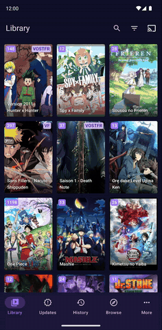
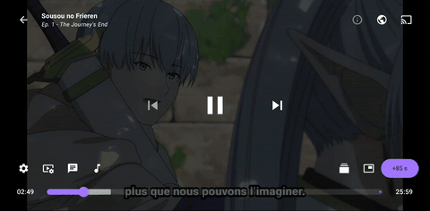
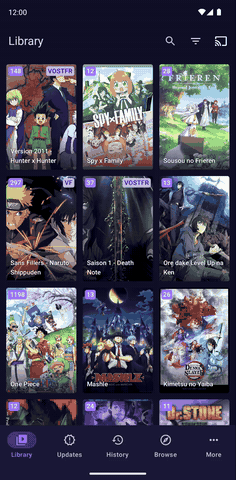
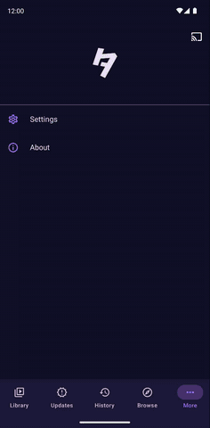

# Tadami (タダ見)

Tadami is a learning project heavily inspired by the free and open source manga reader Tachiyomi with anime capabilities instead for Android 9.0 and above.
It is not a production ready app and mostly a protoype used to learn android development with kotlin, jetpack compose...

## Download
Get the latest version from the [releases page](https://github.com/tadamiorg/tadami/releases/latest).

## Ui

### Library

### Browse

### Player

### Anime details

### Settings

